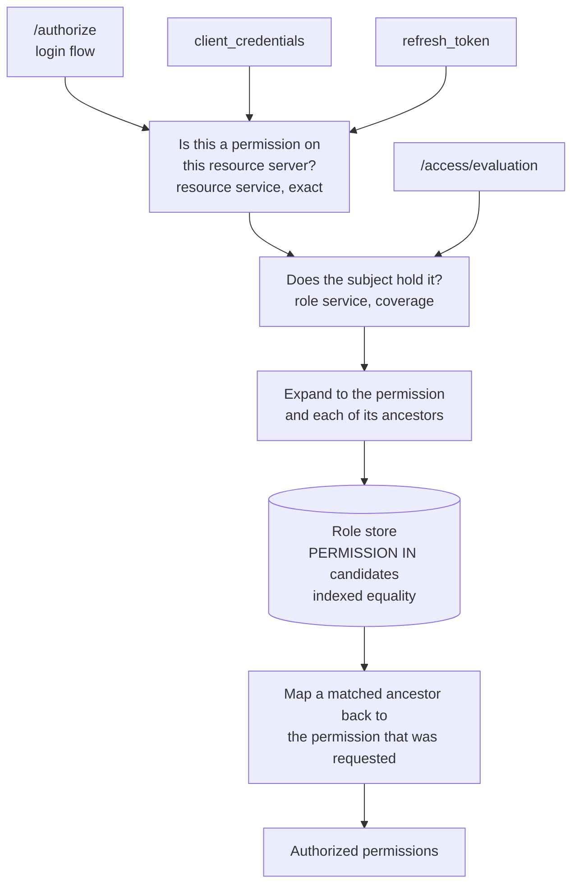
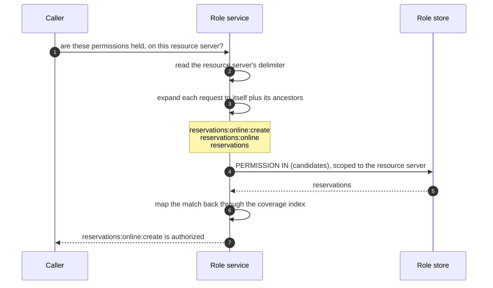

# Hierarchical permissions

- **Status:** Draft
- **Version:** 0.4
- **Related documents:** [Design Discussion #5990](https://github.com/thunder-id/thunderid/discussions/5990), Issue #5988, [Resource servers guide](../../docs/content/guides/resource-servers.mdx), [Roles guide](../../docs/content/guides/users/manage-roles.mdx), RFC 6749 §3.3

## Summary

ThunderID already models permissions as a tree. Resources nest, and each resource and action carries a permission string built as `parent + delimiter + handle`. A handle may not contain its resource server's delimiter, so every delimiter-separated prefix of a permission string is exactly one of its ancestors. That invariant is enforced when a resource is created.

Nothing used it. Granting a role `reservations` granted the literal string `reservations` and nothing else, so a request for `reservations:create` was denied even though the role held the resource that contains it. The one exception was the management API gate, which has always expanded `system` into `system:user:view` and so on, leaving ThunderID with two different permission semantics depending on which resource server a caller was talking to.

The governing decision is that **a grant is a rule, not a list**: granting a resource grants what it contains, including resources and actions created after the grant was made. The alternative, expanding a grant into its descendants when the role is saved, goes stale the moment the catalogue changes and reintroduces the catalogue-synchronisation cost this removes.

This specification makes the tree mean something, through one mechanism:

- **Coverage.** A permission authorizes itself and everything beneath it on the same resource server. Evaluated wherever ThunderID decides what a subject may do, so one grant of a parent answers for the whole subtree.

**It applies only where the resource server asked for it.** What a scope string means belongs to the resource server, and RFC 6749 §3.3 assigns scope values no internal meaning, so ThunderID does not impose one on an API it does not own. A resource server declares `hierarchicalPermissions` when it is created; the default is off, which is exactly today's behaviour, so an upgrade changes nothing until somebody opts in.

Deliberately not here, and raised as an open question instead: dropping redundant scopes from issued tokens. It is not needed for coverage and carries a decision of its own.

Three things follow. A role can grant a subtree once instead of enumerating it. A permission added beneath a granted resource is usable without re-granting, so a resource server team can evolve its catalogue on its own cadence. And the two permission semantics collapse into one, removing the special case the management API has carried.

## Architecture



Responsibilities:

- **The resource service** owns the catalogue and answers whether a permission exists. This check is unchanged: a descendant is its own row, so it is found by exact match either way.
- **The role service** owns entitlement and is the single place coverage is applied. Four surfaces reach it, so coverage lands on all four at once: the authorization endpoint through the login flow's authorization executor, the client credentials grant, the refresh grant, and the AuthZEN evaluation endpoint through the RBAC engine.
- **The role store** is unchanged. The service expands a requested permission into its ancestors before asking, so the store's lookup stays an indexed equality test rather than becoming a prefix scan.
- **One lookup** answers which delimiter a resource server's permissions nest on, or none when they do not. It is read per evaluation rather than cached: the declaration can be turned off after the fact, and a remembered answer would keep authorizing by a relation the resource server has stopped declaring. Entitlement and the grant-escalation check share it.
- **Grant handlers** are unchanged. They receive the authorized set and build a token from it exactly as before.
- **The console** records a parent grant as the parent, rather than walking the subtree and recording every descendant.
- **The management API gate** already applies the same relation to `system` permissions, and now shares one implementation of it with the role service rather than carrying its own.

## Detailed design

### Asking for a resource the subject holds only part of

Coverage answers downward: hold `reservations`, get anything beneath it. The reverse does not hold. A subject holding `reservations:create` and `reservations:view` does not hold `reservations`, because `reservations` would also confer whatever is added beneath it later.

A client asking for `reservations` is nonetheless asking for something the subject can partly satisfy. Refusing outright gives the client nothing, which is wrong in the other direction. So a refused request reports what the subject holds beneath it, and the surfaces that mint a scope set grant those instead. The resource itself is never among them.

This rides on the evaluation's existing `context`, under `granted_instead`, rather than on the decision. The decision stays false, because the question "may this subject do `reservations`" is genuinely answered no. Who honours it follows from what the caller is doing with the answer:

- `/authorize`, `client_credentials`, `refresh_token` and `token_exchange` mint a scope set, so they honour it.
- `/access/evaluation` strips it. It returns the decision itself, and a caller asking whether the subject may act on a resource is owed that answer, not a list of other things it may do.
- An AuthZEN policy decision point never produces it. An external PDP has no view of this permission tree, so a resource server configured with one does not get this behaviour. That difference is a property of choosing an external engine, and is documented as one.

### Where the relation applies

A resource server declares `hierarchicalPermissions` when it is created. Off, which is the default, every permission on it is matched exactly and nothing about its behaviour changes. On, a permission covers what sits beneath it.

The declaration can be changed after creation; the delimiter it reads with cannot, since the permission strings were built from it. It is read at evaluation time rather than copied into grants, so turning it on widens every existing grant of a parent at once and turning it off narrows them, in both cases without rewriting any role. That is the point: an administrator who turns it off has one action that stops the relation applying everywhere on that resource server, which is what makes it a usable control rather than a decision frozen at creation.

Turning it off does not reach tokens already issued. A token minted while it was on carries the descendant permissions by name, and those keep working until they expire. Access tokens are short-lived; the refresh grant re-evaluates, so the next refresh narrows to what the resource server now declares.

It is stored in the resource server's existing properties, so there is no schema change, and it is read back through the same path as the delimiter. A declarative resource server carries it in its document.

A permission that only an ancestor authorized is checked against the catalogue before it is issued. Nothing grants it by name, so nothing has ever validated it: without the check, any string beneath a held permission would authorize itself and a client could mint a scope the resource server never declared. A permission a role grants by name skips the check, since role permissions are validated against the catalogue when the role is written, and a resource server whose permissions do not nest never reaches it. A catalogue that cannot be read refuses the inherited permissions rather than admitting them.

Three failures all reduce to exact matching rather than to an assumed relation: a resource server that did not declare it, one that cannot be read, and a caller that named none. Each denies a permission an ancestor would have conferred rather than granting one.

### Coverage

A permission *covers* another when they are equal, or when the second begins with the first followed by the resource server's delimiter.

```
reservations                covers  reservations:create          (parent)
reservations                covers  reservations:online:create   (ancestor)
reservations:create         covers  reservations:create          (itself)
reservations:create     does not cover  reservations             (upward)
reservations:view       does not cover  reservations:create      (sibling)
reserve                 does not cover  reservations:create      (prefix, not an ancestor)
```

Coverage is evaluated within one resource server. A permission held on one never covers anything on another, even when the strings match.

The delimiter is the resource server's own, read from its record rather than assumed to be a colon. Resource servers may use any of `. _ : - /`. When the resource server cannot be read, the delimiter is empty and coverage reduces to equality, which denies a parent-covered permission rather than granting one. Every failure in this path is closed in that direction.

Coverage never runs upward. Holding part of a subtree must not confer the subtree, because the resource's own permission is a permission in its own right and because it would also confer anything added beneath it later.

### Entitlement evaluation

The role service answers "which of these permissions does this subject hold". A subject holds a permission when any permission in their effective set, across all their roles, direct and through groups, covers it.

Implemented by expanding each requested permission into the set of permissions that would authorize it, which is the permission itself plus its ancestors, asking the store about all of them at once, and mapping matches back:

```
requested:   reservations:online:create
asked:       reservations:online:create, reservations:online, reservations
role holds:  reservations
answer:      reservations:online:create is authorized
```

The expansion is bounded by the depth of the tree, typically two or three extra strings per requested permission. It happens in the service, where the delimiter is known, so the store's `PERMISSION IN (...)` lookup keeps using its index. Rewriting that predicate as a prefix comparison would make it non-sargable and scan every permission row for every role in the deployment.

The result reports the permissions that were *requested*, not the ancestor that matched. Callers compare against the string they asked about, so returning the ancestor would read as a denial.



One candidate can authorize several requested permissions at once, which is why the expansion keeps a reverse index from each candidate to the requests it would satisfy rather than a flat list.

### Grant semantics

Granting a permission grants everything it covers, including resources and actions created afterwards. A grant is a rule over a subtree, not a snapshot of its contents.

The alternative, expanding a grant into its descendants when the role is saved, was rejected. It goes stale as soon as the catalogue changes, producing a silent failure ("I added an action and nobody can use it") that surfaces as an authorization bug rather than a modelling one. It makes the role table grow with the resource tree. And it forces a re-grant whenever a resource server evolves, which is the catalogue-synchronisation cost this feature exists to remove.

The consequence is real and must not be hidden: an administrator granting `reservations` is granting something whose contents can change without them acting again. For an autonomous agent there is no login in between, so the extension takes effect with no human involved at any point.

Mitigations, rather than reversing the decision:

- The console states on parent selection that the grant covers current and future permissions beneath it.
- The role keeps displaying the parent rather than an expansion, so the open-ended nature stays visible on every later read.
- Fine-grained assignment is unchanged. An administrator who wants an exact list grants an exact list, and gets exactly it.

A per-resource-server switch between the two models was also rejected: it would put two permission semantics in one deployment, which is the inconsistency this removes.

A subtree is therefore granted and released as a unit. Revocation matches a scope by its exact string, so when a role grants `reservations` there is no `reservations:create` row to remove and revoking that descendant on its own has no effect: the resource continues to confer it. Releasing a descendant means removing the resource from the role and granting back the siblings that should remain. Making revocation walk upwards instead, so that revoking a descendant strips any ancestor conferring it, would silently remove every other descendant of that ancestor, which is worse than an explicit administrative action. The permission catalogue enforces the same model at grant time by rendering a descendant conferred by a selected ancestor as held and not clearable from its own row.

### Consent

Consent records what a subject approved, as exact permission strings, and bounds what a token may carry. Two comparisons use it, and both now ask whether an approval covers the permission rather than whether it equals it: the one that decides whether to prompt, and the one that intersects the approved set against the authorized set when the assertion is built.

Changing only the first would be worse than changing neither. Suppressing a prompt because an approved resource covers the permission, while the intersection still compared exactly, would leave consent holding the resource and authorization holding something beneath it, and drop it.

**A refusal outranks an approval that merely contains it.** Decisions are read from the permission outwards and the nearest one wins, so approving a resource and then declining one permission beneath it leaves that one declined, and a refusal higher up does not undo an approval closer in.

Consent cannot widen what roles allow. A subject is only ever asked about permissions they are already authorized for, so an approval broad enough to cover something still only admits what was authorized.

The delimiter reaches both comparisons through the flow's runtime data, recorded by the authorization step once it has resolved the bound resource server. A flow with no authorization step, or one bound to a resource server whose permissions do not nest, leaves it empty and both comparisons stay exact. It is excluded from SSO checkpoint snapshots for the same reason the resource server identifier is: replayed onto an app bound to a different resource server, it would have that app's permissions compared by a relation its own resource server never declared.

### Granting what you do not hold

The existing check that refuses a grant exceeding the caller's own permissions evaluates the same relation, and is told each resource server's delimiter rather than assuming one.

It previously assumed a colon on every resource server, which both over- and under-permitted: on a resource server using another delimiter a genuine parent did not cover its own child, so a legitimate grant was refused, while two unrelated permissions that happened to contain a colon were read as parent and child, so a grant the tree does not support was approved. Both are closed by resolving the delimiter, and the check now agrees with entitlement rather than contradicting it.

### Data model

No schema change. The declaration is stored in the resource server's existing properties. Resources already carry `PARENT_RESOURCE_ID` and a materialised `PERMISSION`, and roles already store permission strings per resource server, verbatim as assigned. Grants are neither expanded nor reduced on write; the expansion described above happens per request and never touches storage. A subtree granted through the permission catalogue now stores one row where it previously stored one per descendant, which is a consequence of the console change rather than of the storage model.

No migration. A role holding a materialised expansion authorizes exactly what a role holding the parent authorizes, so existing roles keep working untouched. Normalising them is optional cleanup, not a prerequisite.

### API

`hierarchicalPermissions` is accepted on resource server creation and update, and reported on reads. On update it is read as `false` when omitted, like any other boolean in the request, so a client that updates a resource server without sending it turns the relation off. The console sends the current value on every save for that reason. Assigning a parent permission was already accepted: a resource carries a permission string of its own, and role permission validation already accepts either a resource's permission or an action's.

Two observable behaviour changes. A scope request covered by a held parent is now granted where it was previously dropped silently. And a request for a resource the subject does not hold outright is answered with the permissions it holds beneath that resource, where it was previously refused outright. The shape of the `scope` claim is unchanged, since it still carries exactly the permissions that were requested and authorized.

### UI

The resource server creation wizard carries the declaration on the step that already chooses the delimiter, since the two are the same decision: unticked, the delimiter only formats permission strings; ticked, it also decides which permissions confer which. Ticking it states the consequence that is not otherwise visible: a grant covers permissions added beneath it later, so a resource added under one a role already grants is granted too. Nothing is said about choosing a delimiter that avoids occurring inside a permission name, because a handle containing the delimiter is refused when the resource is created, so the case the advice warned against cannot arise.

The permission catalogue records a parent selection as the parent alone, instead of walking the subtree and recording every descendant. Consequences:

- Selecting a resource drops any descendant already listed, which the resource now confers.
- Clearing a resource also clears its ancestors, which would otherwise keep conferring it, and its descendants, so a role written as a materialised expansion is fully released by one click.
- A permission conferred by a selected ancestor is shown as checked and cannot be cleared from its own row. Clearing the ancestor is what releases it. Granting all but one descendant means clearing the ancestor and selecting the rest, which is an accurate reflection of what the role can express.
- Selection state no longer needs the subtree loaded, so expanding a resource no longer fetches its descendants just to render a checkbox.

The server-level "select all" is unchanged and still enumerates, because a resource server is not itself a permission and so has no parent string to grant.

### Configuration

None. No new keys, no feature flag.

## Requirements

### R1. A parent permission authorizes what it contains

**Requirement:** A subject granted a resource's permission is authorized for every permission beneath that resource on the same resource server, without those being granted individually.

**Acceptance criteria:**

- **AC1.1:** Given a role granting `reservations` and a request for `reservations:create`, when the subject's entitlement is evaluated, then `reservations:create` is authorized.
- **AC1.2:** Given a role granting `reservations` and a request for `reservations:online:create`, when entitlement is evaluated, then it is authorized, so coverage is not limited to one level.
- **AC1.3:** Given a role granting `reservations:create` and a request for `reservations`, when entitlement is evaluated, then it is denied.
- **AC1.4:** Given a role granting `reservations:view` and a request for `reservations:create`, when entitlement is evaluated, then it is denied.
- **AC1.5:** Given a role granting `reservations` on one resource server and a request for `reservations:create` on another, when entitlement is evaluated, then it is denied.
- **AC1.6:** Given a resource server whose delimiter is `/` and a role granting `reservations`, when `reservations/create` is requested, then it is authorized.
- **AC1.7:** Given a resource server that cannot be read, when any permission is requested, then only an exactly matching grant authorizes it.

### R2. Coverage applies wherever ThunderID decides what a subject may do

**Requirement:** The same entitlement rule governs the authorization endpoint, the client credentials grant, the refresh grant, and access evaluation.

**Acceptance criteria:**

- **AC2.1:** Given a user whose role grants `reservations`, when a client requests `scope=reservations:create` at `/authorize`, then the issued token carries `reservations:create`.
- **AC2.2:** Given an app whose role grants `reservations`, when it requests `scope=reservations:create` via client credentials, then the issued token carries it.
- **AC2.3:** Given a subject whose role grants `reservations`, when a resource server asks `/access/evaluation` whether they may `reservations:create`, then the decision is permit.
- **AC2.4:** Given a requested permission that is not defined on the bound resource server, when it is requested, then it is dropped regardless of what the subject holds.
- **AC2.5:** Given a resource server that has not declared its permissions hierarchical, when the same grant and request are evaluated against it, then only an exactly matching grant authorizes the request.
- **AC2.6:** Given an administrator holding a resource on a resource server whose permissions nest, when they grant a permission beneath it, then the grant is permitted; and given the same on a resource server whose permissions do not nest, then it is refused.

### R3. A subtree is granted by granting the parent

**Requirement:** An administrator grants a subtree by assigning one permission, and the role continues to show that permission rather than an expansion.

**Acceptance criteria:**

- **AC3.1:** Given the permission catalogue, when an administrator selects a resource, then the role records that resource's permission alone.
- **AC3.2:** Given a selection that already lists descendants of a resource, when that resource is selected, then the descendants are dropped from the selection.
- **AC3.3:** Given a selected resource, when a descendant's row is inspected, then it is shown as held and cannot be cleared from that row.
- **AC3.4:** Given a role that lists a resource and every descendant individually, when the resource is cleared, then the descendants are cleared with it.
- **AC3.5:** Given a role created before this change holding a materialised expansion, when its permissions are evaluated, then it authorizes exactly what it authorized before.

### R4. Consent follows the same relation, and a refusal stays refused

**Requirement:** An approval covers the permissions beneath it, so a subject is not asked again for something they already approved more broadly, while consent continues to bound what a token carries.

**Acceptance criteria:**

- **AC4.1:** Given a flow that collected consent, when a token is issued, then its permission scopes are within what was consented.
- **AC4.2:** Given a permission the subject is authorized for but did not consent to, when a token is issued, then it is absent.
- **AC4.3:** Given a subject who approved a resource, when a permission beneath it is authorized, then they are not prompted again and it is issued.
- **AC4.4:** Given a subject who approved a resource and declined one permission beneath it, when that permission is authorized, then it is not issued.
- **AC4.5:** Given a subject who declined a resource and approved a permission beneath it, when that permission is authorized, then it is issued, since the nearer decision wins.
- **AC4.6:** Given a resource server whose permissions do not nest, when consent is resolved, then approvals are compared exactly.

## Open questions

1. **Should redundant scopes be dropped from issued tokens?** A token could drop a permission scope that another scope in the same set already satisfies. It would be removal only, never introducing a parent the set did not carry. The redundancy comes from the client's request rather than from the role: a client sending `scope=reservations reservations:create` receives both strings however tidily the role is modelled, because the granted set is what was requested intersected with what is held and nothing deduplicates it. The benefit is therefore narrow, and it changes what a resource server receives, since most enforce a scope claim by exact match.
2. **Should changing the declaration require confirmation naming what it affects?** Turning it on widens every existing grant of a parent on that resource server at once, and turning it off narrows them, both in one administrative action with no prompt at the point the grants were made. The console could name the roles whose grants the change reaches before applying it.
3. **Should creating a resource beneath a granted subtree emit an audit event** naming the roles whose grants it extends? It is the strongest mitigation for grants covering what is added later.
4. **Where is a resource server's delimiter published,** so one reading a token's scope claim itself can apply the same relation without calling the management API?
5. **How should a personal access token carry this?** A token minted against a permission rather than against a resource server has no delimiter to resolve, so the relation would silently not apply to it. Worth settling before that feature lands rather than after.
6. **Should the role API reject or normalise a redundant permission?** Role validation checks only that each permission exists, so a role may list both a resource and a descendant of it. The rows authorize the same thing, but dropping the descendant then records a revocation for something the resource still confers. Rejecting it would make every role still holding a materialised expansion un-editable; normalising on write would silently rewrite what an administrator submitted.
7. **Confirming that a subtree is released as a unit.** A revocation is derived from the permission strings a role stops granting, compared exactly, so a role granting only a resource can only revoke that resource: releasing one descendant cannot be asked for. Releasing one means removing the resource and granting back the siblings that remain.

## Change log

| Version | Date | Change |
|---|---|---|
| 0.1 | 2026-10-22 | Initial specification. |
| 0.2 | 2026-10-23 | Scoped to coverage. Dropping redundant scopes from tokens, and the refresh narrowing rules, moved to open questions; the architecture, responsibilities and API sections corrected to match. Recorded that a subtree is granted and released as a unit. Removed an unsubstantiated claim about gateway behaviour from the motivation. |
| 0.4 | 2026-10-27 | Made the relation opt-in per resource server, declared at creation, so the semantics belong to the resource server rather than being imposed on every API. Recorded that refresh narrowing and token exchange now follow the same relation, that consent does too with a refusal outranking a broader approval, and that the grant-escalation check is told each resource server's delimiter rather than assuming a colon. |
| 0.3 | 2026-10-23 | Corrected three open questions against the code: narrowing a refresh already loses the grant it narrowed from, which is pre-existing and retained; token scope redundancy originates in the client's request rather than the role; and releasing one descendant of a granted resource cannot be asked for through role editing. Added the role API's acceptance of redundant permissions, and caching the delimiter, as questions. |
