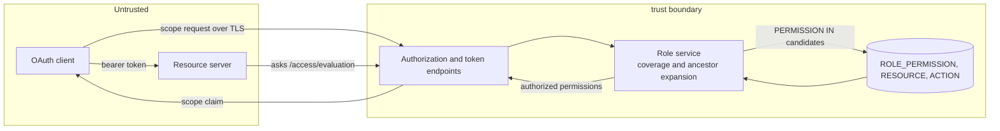
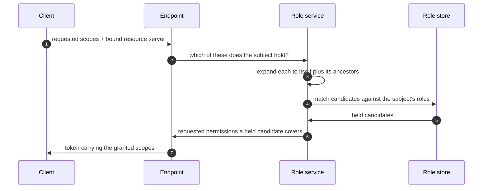
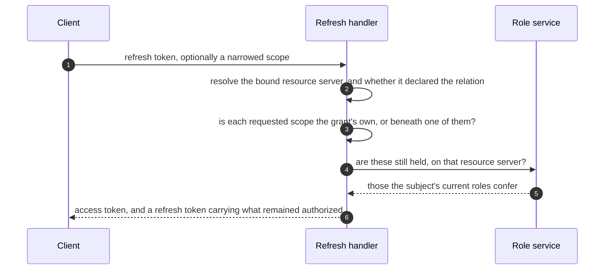
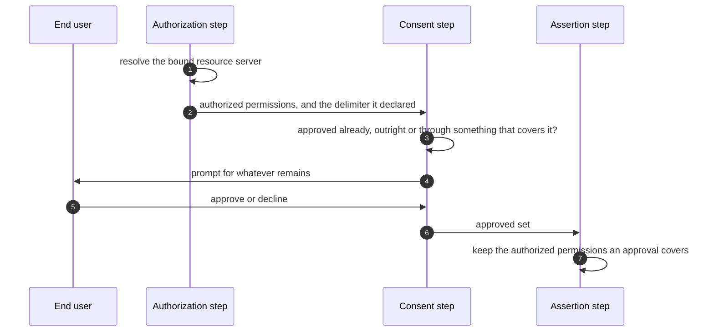

# Hierarchical permissions threat model

This model covers permission coverage: a granted permission authorizing what it contains, where that relation applies, and the ancestor expansion used to evaluate it.

## Overview

Hierarchical permissions change how ThunderID answers "does this subject hold this permission". A granted permission now authorizes itself and everything beneath it on the same resource server. That changes what a decision permits, so the area is authorization-critical: a matching rule that runs one step too far, or in the wrong direction, grants access nobody assigned.

The relation is declared per resource server and off by default, so a deployment that opts nothing in behaves exactly as before. That declaration is the primary control: it decides where the relation applies at all, and it is read at evaluation time, so turning it off stops the relation applying to every grant on that resource server at once.

Nothing about how a token is constructed changes. The scope claim still carries exactly the permissions that were requested and authorized, so what the feature alters is which requests are authorized, not what a token looks like afterwards.

The entry points are the authorization endpoint, the token endpoint (client credentials, refresh and token exchange grants), the AuthZEN access evaluation endpoint, and the role management API that records grants.

Cross-cutting concerns covered elsewhere: client authentication, token signing and verification, refresh-token rotation and replay detection, the authentication flow and its consent step, and the federated authorization mapping that resolves external claims to local references. These are trust inputs here, not re-analysed.

## Scope

This model covers:
- Evaluating whether a subject holds a requested permission, including the ancestor expansion used to answer it
- Applying that evaluation at the authorization endpoint, the client credentials, refresh and token exchange grants, and access evaluation
- Deciding where the relation applies, and what happens where it does not
- The comparisons that read a consent record, and the check that refuses a grant exceeding the caller's own permissions
- Recording a subtree grant through the role API and the permission catalogue, and what releasing one entails

Out of scope:
- How a subject comes to hold a role at all (role assignment authorization, covered by the system authorization model)
- Token integrity, audience binding, and token revocation mechanics
- Consent collection and storage. How an approval is recorded is unchanged; the comparisons that read it are in scope below
- Dropping redundant scopes from a token, an open question in the specification and not implemented, so not analysed here.

## Architecture

### Components

| Component | Task |
| --- | --- |
| Resource service | Owns the permission catalogue and the per-resource-server delimiter. Answers whether a permission exists. Enforces that a handle never contains the delimiter, which is the invariant coverage depends on. |
| Role service | The single place coverage is applied. Expands a requested permission into its ancestors, asks the store about all of them, and maps a match back to the permission that was requested. |
| Role store | Unchanged. Matches permission strings by equality against the subject's roles. |
| Grant handlers | Build a token from the authorized set. The refresh and token exchange grants additionally compare what a request narrows to against what was already granted, using the same relation. |
| Security package | Holds the coverage primitives. One-directional prefix matching on an explicit delimiter, with no default applied on behalf of a caller. |
| Permission catalogue (console) | Records a subtree grant as the parent permission. Shows a conferred permission as held and not clearable from its own row. |
| Resource server record | Carries the declaration, which is changeable, and the delimiter, which is fixed at creation. One lookup answers both for entitlement and for the grant check, read per evaluation rather than cached so that a change takes effect at once. |
| Consent enforcer | Decides whether to prompt, and intersects approvals against the authorized set. Both read the same relation, with a refusal outranking an approval that merely contains it. |

### Actors

| Actor | Description | Roles or permissions |
| --- | --- | --- |
| End user | Authenticates interactively and authorizes a client at `/authorize` | Whatever their roles and groups confer |
| OAuth client | Requests scopes on its own behalf or a user's | Its registered grant types |
| Application or agent | Obtains a token for itself through client credentials | Whatever its roles and groups confer |
| Resource server | Receives a token, or asks access evaluation, and enforces the result | N/A, relying party |
| Administrator | Grants permissions to roles | System permissions over roles |

#### Entitlement matrix

| Actor | Request a scope | Be granted a covered descendant | Record a subtree grant | Release a descendant from one |
| --- | --- | --- | --- | --- |
| End user | [Yes] | [Yes] | [No] | [No] |
| OAuth client | [Yes] | [No], it holds no permissions of its own in this flow | [No] | [No] |
| Application or agent | [Yes] | [Yes] | [No] | [No] |
| Resource server | [No] | [No] | [No] | [No] |
| Administrator | [Yes] | [Yes] | [Yes] | [Yes], by removing the resource and re-granting siblings |

### External dependencies (not owned)

| Dependency | Description |
| --- | --- |
| Resource server evaluating a token's scope claim itself | A subject granted a resource may be issued a token carrying that resource rather than a named action beneath it, because that is what the client asked for. A relying party that matches the claim by equality would deny access it should allow, so one reading the claim directly has to apply the same relation, as the management API gate already does for system permissions. Availability impact, not an authorization bypass. A relying party that asks `/access/evaluation` instead is unaffected, since the relation is applied server-side. |

## Threats and mitigations

### Out-of-scope interactions and risks

- Obtaining a role at all, and whether an administrator may grant what they are granting, are owned by the system authorization model's grant-escalation check.
- Stealing or replaying a token is owned by the token and revocation models.

### Interactions

#### [01]: Evaluating a requested permission against a subject's grants

**Description**

A requested permission is expanded into itself plus its ancestors on the bound resource server. The store returns which of those the subject's roles hold. Any match authorizes the permission that was originally requested.

**Assets involved**

| Initiator | Intermediate | Target |
| --- | --- | --- |
| OAuth client or resource server | Authorization or token endpoint, role service | Role permission records |

**Data flow**

**Security considerations**

| Area | Response | Comments |
| --- | --- | --- |
| Data confidentiality | [C-High] | The answer is an authorization decision |
| Communication medium | [M-DB] | |
| Transport security | [TLS] | Client-facing; the store call is in-process |
| Authentication | Established before this step by the grant or the flow | |
| Accessibility | [Public] | Reached from the public token and authorization endpoints |
| Authorization and Access Control | Evaluated per resource server against the subject's roles and transitive groups | |

**Threat assessment**

| ID | Category | Threat | Materializable | Mitigation / comment |
| --- | --- | --- | --- | --- |
| 1 | [Elevation of Privilege] | A subject holding a descendant is treated as holding the resource it sits under, acquiring every sibling. A role granting `reservations:view` would confer `reservations:create` and anything else beneath `reservations`. | [No] | Coverage is one-directional by construction: the held permission must be a prefix of the required one, never the reverse. Covered by a dedicated test asserting a child does not cover its parent. |
| 2 | [Elevation of Privilege] | A permission that merely shares a textual prefix is treated as an ancestor, so `reserve` confers `reservations:create`. | [No] | The prefix test requires the delimiter immediately after the held permission. A handle may not contain the delimiter, enforced at resource creation, so a delimiter boundary always marks a real tree level. |
| 3 | [Elevation of Privilege] | A permission held on one resource server authorizes the same string on another. | [No] | Evaluation is scoped to the bound resource server, and the store query filters on it. Grants are keyed by resource server throughout. |
| 4 | [Elevation of Privilege] | The wrong delimiter is applied, so two sibling permissions are read as ancestor and descendant. | [No] | The delimiter is read from the resource server record and is immutable after creation, so it cannot diverge from the strings built with it. Only whether it is applied at all is changeable. A delimiter that cannot be read yields exact matching, which denies rather than grants. |
| 5 | [Tampering] | A requested permission is reported as authorized because an ancestor matched, and the ancestor is returned instead of the request, so a caller comparing against its own string misreads the answer. | [No] | The service maps a matched candidate back to the requested permissions it covers and returns only those. Tested for the case where one ancestor covers several requests. |
| 6 | [Denial of Service] | Ancestor expansion multiplies the candidate set by the depth of the resource tree, so a request carrying many deep scopes enlarges the store query proportionally. | [No] | Expansion is bounded by tree depth, which the permission column length bounds in turn, and the query remains an indexed equality lookup rather than a scan. Recorded as a bounded residual below, since the requested scope count is not itself capped. |
| 7 | [Elevation of Privilege] | The relation is applied to a resource server that never declared it, so permissions its owner intended as separate values start conferring one another. | [No] | The declaration gates every evaluation, and absent it the delimiter resolves empty, which reduces matching to equality. Turning it on is a privileged change to the resource server, subject to the same authorization as any other update to it. Covered end to end by a test that the same grant and request are refused on a resource server that did not declare it. |
| 8 | [Elevation of Privilege] | A caller supplies the relation itself, naming a delimiter the resource server did not, and has unrelated permissions read as parent and child. | [No] | The delimiter is never taken from a request. It is read from the resource server record on the server side, and the one place it is carried between flow steps is written only by the authorization step. |
| 8a | [Elevation of Privilege] | A client requests a permission the resource server never declared, beneath one the subject holds, and is issued it as a scope. | [No] | A permission authorized only by an ancestor is checked against the catalogue before it is issued, because nothing granted it by name and so nothing has validated it. A permission granted by name needs no check: role permissions are validated when the role is written. A catalogue that cannot be read refuses the inherited permissions rather than admitting them. |
| 9 | [Tampering] | A remembered delimiter outlives a change to the resource server, so evaluations keep using a relation it no longer declares. | [No] | Nothing is cached. The declaration is read from the resource server on each evaluation, so turning it off takes effect on the next one. A read that fails yields exact matching, which denies rather than grants. Tokens already issued still carry the descendants they were minted with until they expire; the refresh grant re-evaluates. |

#### [02]: Narrowing a refresh or a token exchange

**Description**

A refresh re-evaluates the subject's permission scopes against their current roles and groups before issuing a new access token, so entitlement is answered by the same relation as everywhere else.

What a refresh may *request* is bounded by the grant the refresh token carries, and a token exchange by the scopes the subject token carries. Both comparisons now read the relation too, so a client may ask for something beneath what it was granted rather than being refused for asking for less than it holds. Both resolve the delimiter from the resource server the request is bound to, and both compare exactly where it did not declare one. An OIDC scope confers only itself and never stands as an ancestor, even where an application's scope-to-claims mapping names one that looks like a parent.

What the rotated refresh token then carries is unchanged by this feature: a request that narrowed is reissued with what it asked for, so narrowing remains one-way.

**Assets involved**

| Initiator | Intermediate | Target |
| --- | --- | --- |
| OAuth client | Token endpoint, refresh grant handler, role service | Access token and rotated refresh token |

**Data flow**

**Security considerations**

| Area | Response | Comments |
| --- | --- | --- |
| Data confidentiality | [C-High] | Issues a new access token |
| Communication medium | [M-NT] | |
| Transport security | [TLS] | |
| Authentication | Client authentication plus refresh token validation | |
| Accessibility | [Public] | |
| Authorization and Access Control | Re-evaluated against current roles on every refresh | |

**Threat assessment**

| ID | Category | Threat | Materializable | Mitigation / comment |
| --- | --- | --- | --- | --- |
| 7 | [Elevation of Privilege] | Narrowing lets a refresh or an exchange widen beyond what was granted, because a grant of a descendant admits a request for its parent. | [No] | The relation runs one way in both comparisons, so a grant listing only a descendant does not admit its ancestor. Entitlement is then a second, independent barrier: even admitted, the parent is only issued if the subject's current roles confer it. |
| 7a | [Elevation of Privilege] | An OIDC scope in a grant stands as an ancestor, so a grant carrying `profile` admits anything beginning with it. | [No] | OIDC scopes are identified from the application's scope-to-claims mapping and skipped as potential ancestors; one confers only itself. They are not permissions on any resource server, so entitlement would refuse them regardless. |
| 8 | [Elevation of Privilege] | A permission the subject has lost returns on a later refresh, because coverage now finds an ancestor where exact matching found nothing. | [No] | Coverage is evaluated against the subject's *current* roles on every refresh. A scope reappears only when a role currently grants an ancestor of it, which means the subject does hold it. |
| 9 | [Process Risk] | A subject whose role moves from a resource to a descendant of it finds their refresh token grants nothing, because the grant names the resource and holding a descendant does not confer it. | [No] | Correct refusal rather than a bypass: the subject no longer holds what the grant names. They re-authorize to obtain a grant matching what they now hold. More reachable than before, since granting a parent is now the recommended shape, so it is recorded as a residual. |

#### [03]: Reading a consent record

**Description**

Two comparisons read what a subject approved: the one deciding whether to prompt, and the one intersecting approvals against the authorized set when the assertion is built. Both ask whether an approval covers the permission rather than whether it equals it.

**Assets involved**

| Initiator | Intermediate | Target |
| --- | --- | --- |
| End user | Login flow, consent enforcer | Permission scopes carried by the assertion |

**Data flow**

**Security considerations**

| Area | Response | Comments |
| --- | --- | --- |
| Data confidentiality | [C-High] | Decides what the assertion carries |
| Communication medium | [M-IN] | In-process, within one flow execution |
| Transport security | [TLS] | The prompt and the decision travel over TLS |
| Authentication | The subject is authenticated before consent is resolved | |
| Accessibility | [Public] | Reached through the login flow |
| Authorization and Access Control | Bounded by what the subject is authorized for | |

**Threat assessment**

| ID | Category | Threat | Materializable | Mitigation / comment |
| --- | --- | --- | --- | --- |
| 10 | [Elevation of Privilege] | A broad approval overrides a narrower refusal, so a permission the subject explicitly declined is issued because they approved something containing it. | [No] | Decisions are read from the permission outwards and the nearest one wins, so a refusal beneath an approved resource stays refused. Covered by tests in both directions, including a refusal high in the tree not undoing an approval closer in. |
| 11 | [Elevation of Privilege] | Consent admits a permission the subject's roles never granted. | [No] | The comparison filters the authorized set; it cannot add to it. A subject is only ever asked about permissions they are already authorized for. |
| 12 | [Elevation of Privilege] | Suppressing a prompt without matching the intersection leaves the approved set and the authorized set at different levels of the same subtree, and the permission is silently dropped or kept on the wrong basis. | [No] | Both comparisons were changed together. Changing only the prompt would be worse than changing neither, which is why the specification states them as one mechanism. |
| 13 | [Tampering] | A delimiter from one app's authorization request is replayed onto another joining through SSO, so that app's permissions are compared by a relation its own resource server never declared. | [No] | Excluded from SSO checkpoint snapshots, for the same reason the resource server identifier it derives from is. A flow with no authorization step leaves it empty, which compares exactly. |

#### [04]: Recording a subtree grant

**Description**

An administrator grants a resource's permission, which confers everything beneath it, including resources and actions created afterwards.

**Assets involved**

| Initiator | Intermediate | Target |
| --- | --- | --- |
| Administrator | Role API or permission catalogue | Role permission records |

**Security considerations**

| Area | Response | Comments |
| --- | --- | --- |
| Data confidentiality | [C-High] | Defines what the role confers |
| Communication medium | [M-DB] | |
| Transport security | [TLS] | |
| Authentication | Bearer token on the management API | |
| Accessibility | [Restricted] | Requires system permissions over roles |
| Authorization and Access Control | Subject to the existing grant-escalation check | |

**Threat assessment**

| ID | Category | Threat | Materializable | Mitigation / comment |
| --- | --- | --- | --- | --- |
| 14 | [Elevation of Privilege] | A resource or action added later extends every existing grant of its ancestors, with no administrative action and, for an autonomous agent, no interactive step of any kind. | [No] | This is the specified meaning of a subtree grant rather than a defect, and creating a resource is itself a restricted operation performed by the resource server's own administrator. Mitigations are stated in the specification: the console declares the open-ended scope on selection, and the role keeps displaying the parent rather than an expansion. Recorded as an accepted residual, with an audit event on subtree extension as the outstanding improvement. |
| 15 | [Process Risk] | An administrator grants a parent believing it to be a convenient shorthand for today's descendants, and does not realise the grant is open-ended. | [No] | The console states the meaning at the point of selection. Fine-grained assignment remains available and unchanged for anyone who wants an exact list. |
| 16 | [Repudiation] | What a subject could do at a past moment is no longer answerable from the role record alone, because it also depends on the catalogue at that moment. | [No] | Role changes and catalogue changes are both recorded. Reconstructing a past decision requires both, which is a reporting consideration rather than a missing record. |
| 17 | [Elevation of Privilege] | An administrator grants a subtree that exceeds their own permissions. | [No] | The existing check refuses a grant the caller's own permissions do not cover, and now evaluates the same relation as entitlement rather than assuming a colon on every resource server. Assuming one previously both over-permitted, reading two unrelated permissions containing a colon as parent and child, and under-permitted, failing to see a genuine child under another delimiter. Both are closed by resolving the delimiter from the resource server being granted on. |
| 18 | [Process Risk] | An administrator believes they have released one descendant of a granted resource, while the resource continues to confer it, so access they intended to remove remains in force. | [No] | Not reachable through role editing. A revocation is derived from the permission strings a role stops granting, compared exactly, so a role granting only the resource can only ever revoke the resource: releasing one descendant cannot be requested. It arises only where a role lists both a resource and a descendant of it, which the permission catalogue prevents by rendering a conferred descendant as held and not clearable, and which otherwise requires the role API. In that case the descendant is refused at issuance while the resource is still held, which denies rather than grants, and a grant established after the revocation is unaffected because revocations are bounded by establishment time. |

## Security Review Checklist

### Security considerations

| # | Consideration | State | Comments |
| --- | --- | --- | --- |
| 1 | Are all inputs and outputs validated (syntactic and semantic)? | [Yes] | A requested scope must exist on the bound resource server before entitlement is evaluated. Handles and delimiters are validated at resource creation. |
| 2 | Are rate limits in place where necessary? | [N/A] | Unchanged by this feature; see the bounded residual on scope-count amplification. |
| 3 | Are permissions, roles, and entitlements defined on the principle of least privilege and business need? | [Yes] | Fine-grained assignment is unchanged, and a narrow request is granted narrowly even when the subject holds a parent. |
| 4 | Are authentication and authorization validated at both the UI and API layers, front end and back end? | [Yes] | The console records grants; every decision is made server-side. |
| 5 | Are proper isolations in place between components? | [Yes] | Coverage is evaluated per resource server; a grant on one never reaches another. |
| 6 | Have any default credentials been changed? | [N/A] | |
| 7 | Has the implementation followed best-practice guidelines? | [Yes] | RFC 6749 §3.3 for downscoping and §6 for refresh scope bounds. |
| 8 | Are secrets kept out of the public source tree? | [N/A] | |
| 9 | Was a security-focused code review conducted? | [No] | Pending review of this change. Coverage is exercised end to end by integration tests against a live server and database, across access evaluation, client credentials, and the login flow, including the upward, sibling, and shared-prefix cases. |
| 10 | Is SAST or IaC scanning conducted? | [Yes] | Repository-wide, unchanged. |
| 11 | Is SCA conducted? | [Yes] | Repository-wide, unchanged. No new dependencies. |
| 12 | Is DAST or API scanning conducted? | [N/A] | |
| 13 | Are audit logs generated for critical functionality? | [Partial] | Role changes are recorded. Extending a granted subtree by creating a resource is not surfaced against the roles it affects; this is the outstanding mitigation for threat 14. |
| 14 | Do audit logs for critical configuration changes record old and new versions? | [N/A] | Unchanged by this feature. |
| 10 | Are data in transit and at rest encrypted? | [Yes] | Unchanged. |
| 11 | Are sensitive values stored in a secret store or vault? | [N/A] | |
| 12 | Is personal data kept out of logs? | [Yes] | Subject identifiers are masked in the entitlement path, as before. |
| 13 | Have users been given clear instructions for secure usage? | [Partial] | The console declares subtree scope at selection. The resource server guide needs the coverage rule and the delimiter contract. |

### Dependency and component health

| # | Consideration | State | Comments |
| --- | --- | --- | --- |
| 1 | Are dependencies monitored and kept current? | [Yes] | No new dependencies. |
| 2 | Are any End-of-Life components in use? | [No] | |
| 3 | Is hardening guidance published for operators? | [Partial] | Relying parties need documented guidance on expanding coverage. |

## Residual risks (open items)

- **Subtree grants are open-ended by design.** A resource or action created later is conferred by every existing grant of its ancestors, without an administrative action on the role and without any interactive step for an autonomous agent. Accepted as the specified behaviour. The outstanding mitigation is an audit event on resource creation naming the roles whose grants it extends.
- **Scope-count amplification.** Ancestor expansion multiplies the candidate set by the depth of the resource tree. Depth is bounded by the permission column length and the query stays indexed, but the number of scopes a request may carry is not itself capped, so the two multiply. Consider capping requested scopes per request.
- **Relying parties that read the scope claim directly.** A client holding a parent grant may ask for, and receive, a token carrying the resource rather than a named action beneath it. A resource server matching the claim by equality denies access it should allow, with no diagnosable error. Publishing the delimiter so a relying party can apply the same relation is open question 7 in the specification. A relying party using `/access/evaluation` is unaffected.
- **A role may list both a resource and a descendant of it through the API.** The permission catalogue cannot produce that state and role validation does not reject it, since it only checks that each permission exists. Dropping the descendant then records a revocation for something the resource still confers, so that one descendant is refused while the resource is held. It denies rather than grants, and clears once a grant is established after the revocation. Rejecting or normalising redundant permissions on write would remove it, at the cost of making roles that already hold a materialised expansion un-editable.
- **A subject who loses a parent grant but holds a descendant has an empty refresh grant.** Coverage does not run upward, so a refresh evaluates the resource the grant names, authorizes nothing, and the subject must re-authorize. Pre-existing in shape, more reachable now that granting a parent is the recommended pattern.
- **The declaration cannot be turned on later.** A resource server that populated a catalogue before deciding it wants the relation has to be recreated to get it, which means recreating its resources and actions and re-granting every role that named them. The alternative, allowing it to be enabled, widens every existing grant of a parent in one administrative action. Open question 2 in the specification.
- **A personal access token has no resource server to resolve a delimiter from.** Minted against a permission rather than against a resource server, the relation would silently not apply to it. Worth settling before that feature lands. Open question 5.
- **The consent and assertion comparisons read the delimiter from flow runtime data** rather than resolving it themselves, so they depend on the authorization step having run and on the snapshot exclusion holding. Both failure modes leave it empty, which compares exactly, but the dependency is worth stating rather than leaving implicit.

## Appendix

- References: RFC 6749 §3.3 (scope downscoping), RFC 6749 §6 (refreshing an access token), [Hierarchical permissions specification](spec.md)

## Change log

| Version | Date | Change |
|---|---|---|
| 0.1 | 2026-10-22 | Initial threat model. |
| 0.2 | 2026-10-23 | Narrowed to coverage. Removed the interaction modelling reduction of a scope set and the refresh narrowing rules, neither of which is implemented; replaced the refresh interaction with what a refresh now does. Added the threat that releasing one descendant of a granted resource is not possible without releasing the subtree. |
| 0.4 | 2026-10-27 | Recorded that the relation is declared per resource server and off by default, and added the threats that gate covers. Added the interaction for reading a consent record, with a refusal outranking a broader approval and the SSO replay of the delimiter. Recorded that the grant-escalation check now resolves the delimiter instead of assuming a colon, which it both over- and under-permitted on. |
| 0.3 | 2026-10-23 | Corrected the threat and residual covering release of a single descendant: it is unreachable through role editing, since a revocation is derived from the strings a role stops granting, and arises only where a role lists both a resource and a descendant through the API. |
